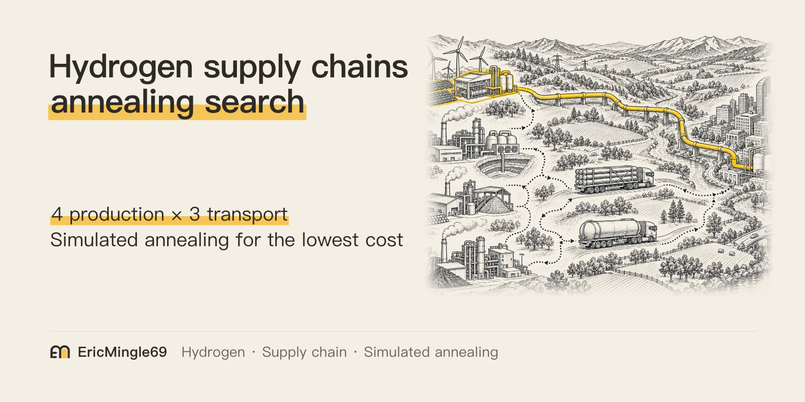

<picture>
  <source media="(prefers-color-scheme: dark)" srcset="readme-assets/cover-en-dark.png">
  
</picture>

<p align="center">
  <a href="#quick-start">Quick start</a> ·
  <a href="实验数据.zip">Experiment archive</a> ·
  <a href="文件夹结构.txt">Structure notes</a> ·
  <a href="https://github.com/Ming-Sir-69">Author</a>
</p>

<p align="center">
  
  <a href="readme-assets/PERSONAL-DOCUMENTATION-LICENSE.md"></a>
  
  
  
</p>

<p align="center">
  <a href="README.md">简体中文</a> · <b>English</b>
</p>

# Hydrogen Supply-Chain Cost Models: Simulated-Annealing Candidate Search

This project contains Python and MATLAB experiments for four hydrogen production and transport cost models. Four production methods and three transport methods form 12 initial candidates. The search randomly changes the selected methods and updates candidates with a simulated-annealing acceptance rule. An Excel experiment archive is grouped by model. The current code does not implement the firefly algorithm's brightness and distance-based attraction, and it provides no independently verified policy findings.

## Features

- **Four objective functions**: cost without subsidy, direct financial subsidy, proportional cost sharing, and environmental cost with a green subsidy.
- **Discrete candidate search**: choices among Green, SMR, ATR and CCS, and among Pipeline, Truck and LiquefiedTruck; production and transport quantities remain fixed during the main search.
- **Temperature and stopping controls**: initial temperature estimated from a target acceptance rate, at most 1000 iterations, and stopping when the best fitness changes by less than `1e-4` over a 200-value window.
- **Two entry types**: Python entries print the search directly; MATLAB entries call Python modules in the corresponding directory through `py.*`<sup>[[2]](#references)</sup>.
- **Historical experiment archive**: 209 XLSX files grouped from model0 through model3; their contents have not been independently rebuilt and checked with the current code.

| Model | Objective | Initial production (kg) | Pipeline distance (km) |
|---|---|---:|---:|
| [model0](model0/) | Production cost + transport cost | 1350 | 2500 |
| [model1](model1/) | model0 − direct financial subsidy | 450 | 2500 |
| [model2](model2/) | model0 × (1 − cost-sharing ratio) | 2250 | 2500 |
| [model3](model3/) | model0 + environmental cost − green subsidy | 1350 | 2400 |

## Quick start

Install Python 3 and NumPy<sup>[[1]](#references)</sup>. The repository has no dependency lockfile, tests or continuous-integration configuration. Run all four Python entries from the repository root:

```sh
python3 -c 'import numpy'
for model in 0 1 2 3; do
  (cd "model${model}" && python3 -B "simulated_annealing_firefly_model${model}.py")
done
```

All four entries completed and printed results with Python 3.14.7 and NumPy 2.5.0. The code does not set a random seed, so candidate solutions, fitness values and output before stopping can differ between runs. Archived values are not fixed outputs of every run.

To run one model, enter its directory and invoke its entry, for example:

```sh
cd model0
python3 -B simulated_annealing_firefly_model0.py
```

## Usage

### Change model inputs

Each model directory has an `initialize_parameters.py` containing production quantity, transport distances, unit costs, environmental costs and subsidy parameters. Transport quantity is fixed at `3/5` of production quantity. Truck and liquefied-truck distances are `3/5` and `2.6/5` of pipeline distance. These values are embedded inputs; the repository includes neither their data sources nor calibration records.

`calculate_fitness_model*.py` defines the objective and `simulated_annealing_firefly_model*.py` runs the search. After changing inputs, run from the corresponding model directory so that modules with identical names are not loaded from another directory.

### MATLAB entries

Each model includes `matlab_script_model*.m` and `matlab_script_model*_modified.m`. Both script types hard-code a Windows Python 3.11 executable path. Before running, set the local interpreter with `pyenv` and check the current directory and Python module search path<sup>[[2]](#references)</sup>.

The modified scripts also write Excel files, generate statistical plots and assume that `../实验数据/<model>/` and `optimal_solutions/` output directories exist. The repository supplies only the compressed archive, not these expanded directories. MATLAB versions, toolbox dependencies and the modified output workflow were not verified in this review.

## Design

1. Generate 4 × 3 = 12 initial candidates, each with one production method, one transport method and fixed quantities.
2. For every candidate in each iteration, randomly select new production and transport methods while keeping quantities unchanged.
3. Accept a lower-fitness candidate. Accept a higher-fitness candidate with probability `exp((old − new) / T)`.
4. Adjust initial temperature from 5000 toward a target acceptance rate of 0.66 with tolerance 0.01. This estimation step temporarily randomizes quantities, unlike the fixed quantities in the main search.
5. Run at most 1000 main-search iterations and inspect the latest 200 best-fitness values every four iterations.

This procedure contains the random proposals and Metropolis acceptance form of simulated annealing<sup>[[1]](#related-work)</sup>. The brightness attraction, distance decay and position updates of the standard firefly algorithm are absent from the current implementation<sup>[[2]](#related-work)</sup>. The repository name is therefore not evidence of a complete hybrid-algorithm implementation.

## Limitations

- With the default parameters, the Python entries multiply temperature by **1.2825 (model0 and model1) or 1.34325 (model2 and model3)**. Both exceed 1, so temperature increases despite the cooling terminology.
- The returned `best_solution` shares a dictionary reference with the population. Later updates can change the saved solution, so the printed solution may not correspond to the recorded best fitness.
- No random seed, repeated experiments, tests, baseline comparison or parameter sensitivity analysis is provided. The code does not establish algorithm performance or subsidy-policy effects.
- In model3, transport environmental cost is multiplied by transport quantity without distance, inconsistent with the parameter comment's unit of CNY/kg/km.
- Cost, environmental-cost and subsidy parameters have no documented sources. The Excel archive has not been independently rebuilt and is not a verified research result.
- MATLAB scripts contain machine-specific paths and output-directory assumptions. Their compatibility was not verified in the current environment.

## Development

This repository contains source and historical experimental material, with no distribution package, version tags, contribution guide or continuous integration. Files under `__pycache__/` are committed runtime caches, not separate source. Code changes require additional reproducible experiments, parameter provenance and result checks; this documentation draft leaves those behaviors unchanged.

[Structure notes](文件夹结构.txt) describe the directories, and the [experiment archive](实验数据.zip) retains historical XLSX files. See the [personal documentation license](readme-assets/PERSONAL-DOCUMENTATION-LICENSE.md) for the documentation licensing scope.

## Acknowledgements

- NumPy provides random-candidate generation and numerical interfaces<sup>[[1]](#references)</sup>.
- MathWorks documents Python-environment configuration in MATLAB<sup>[[2]](#references)</sup>.
- The cover illustration was generated with an image-generation model and processed by this project.

## References

1. Harris, C. R., Millman, K. J., van der Walt, S. J., et al. (2020). Array programming with NumPy. *Nature*, 585(7825), 357–362. <https://doi.org/10.1038/s41586-020-2649-2>
2. MathWorks. *pyenv — Change default environment of Python interpreter*, R2026b. <https://www.mathworks.com/help/matlab/ref/pyenv.html>

## Related work

These publications provide algorithmic comparisons. Their inclusion does not imply that the current source was implemented from them.

1. Kirkpatrick, S., Gelatt, C. D., & Vecchi, M. P. (1983). Optimization by Simulated Annealing. *Science*, 220(4598), 671–680. <https://doi.org/10.1126/science.220.4598.671>. Relates to random candidates and temperature-dependent acceptance of worse solutions.
2. Yang, X.-S. (2009). Firefly Algorithms for Multimodal Optimization. *Stochastic Algorithms: Foundations and Applications*, 169–178. Springer. <https://doi.org/10.1007/978-3-642-04944-6_14>. Describes brightness attraction and distance decay; the current code does not implement these updates.

## Repository structure

| Path | Contents |
|---|---|
| `model0/` | Production and transport cost model without subsidy, with entries |
| `model1/` | Direct financial subsidy model and entries |
| `model2/` | Proportional cost-sharing model and entries |
| `model3/` | Environmental-cost and green-subsidy model and entries |
| `实验数据.zip` | 209 historical XLSX files and directory entries |
| `文件夹结构.txt` | Original directory notes |
| `readme-assets/` | Covers, themed headers, signature assets and documentation license |

---

Maintained by <picture><source media="(prefers-color-scheme: dark)" srcset="readme-assets/em-logo-dark.svg"></picture> <b>EricMingle69</b> · <a href="https://github.com/Ming-Sir-69">Ming-Sir-69</a><br>
The root provides no unified license for source code, existing data or third-party materials; reuse and redistribution rights require separate confirmation. The existing licensing scope for original wording in this documentation refresh is given in the [personal documentation license](readme-assets/PERSONAL-DOCUMENTATION-LICENSE.md).
