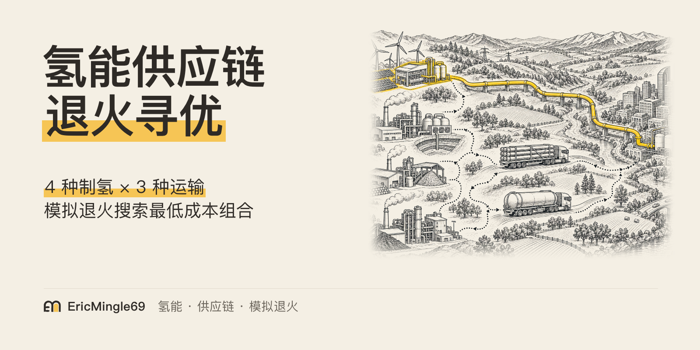

<picture>
  <source media="(prefers-color-scheme: dark)" srcset="readme-assets/cover-zh-dark.png">
  
</picture>

<p align="center">
  <a href="#快速开始">快速开始</a> ·
  <a href="实验数据.zip">实验归档</a> ·
  <a href="文件夹结构.txt">结构说明</a> ·
  <a href="https://github.com/Ming-Sir-69">作者主页</a>
</p>

<p align="center">
  
  <a href="readme-assets/PERSONAL-DOCUMENTATION-LICENSE.md"></a>
  
  
  
</p>

<p align="center">
  <b>简体中文</b> · <a href="README.en.md">English</a>
</p>

# 氢能供应链成本模型：模拟退火候选搜索

本项目保存四种氢能生产与运输成本模型的 Python 和 MATLAB 实验代码。四种制氢方式与三种运输方式组成 12 个初始候选，搜索过程随机改选方式，并按模拟退火接受规则更新候选。仓库另附按模型分组的 Excel 实验归档；当前代码不包含萤火虫算法的亮度与距离吸引更新，也不提供已独立验证的政策结论。

## 主要功能

- **四种目标函数**：无补贴成本、直接资金补贴、比例成本分担、环境成本与绿色补贴。
- **离散候选搜索**：在 Green、SMR、ATR、CCS 与 Pipeline、Truck、LiquefiedTruck 之间改选，主搜索固定生产量和运输量。
- **温度与停止控制**：根据目标接受率估计初始温度，最多迭代 1000 次；最佳适应度在 200 次窗口内变化小于 `1e-4` 时停止。
- **两类运行入口**：Python 入口直接打印搜索过程；MATLAB 入口通过 `py.*` 调用对应目录的 Python 模块<sup>[[2]](#参考文献)</sup>。
- **历史实验归档**：压缩包含 209 个 XLSX 文件，按 model0 至 model3 分组；归档内容尚未由当前代码独立重建核对。

| 模型 | 目标函数 | 初始生产量（kg） | 管道距离（km） |
|---|---|---:|---:|
| [model0](model0/) | 生产成本 + 运输成本 | 1350 | 2500 |
| [model1](model1/) | model0 − 直接资金补贴 | 450 | 2500 |
| [model2](model2/) | model0 ×（1 − 成本分担比例） | 2250 | 2500 |
| [model3](model3/) | model0 + 环境成本 − 绿色补贴 | 1350 | 2400 |

## 快速开始

准备 Python 3 和 NumPy<sup>[[1]](#参考文献)</sup>。仓库没有依赖锁文件，也没有测试或持续集成配置。在仓库根目录运行四个 Python 入口：

```sh
python3 -c 'import numpy'
for model in 0 1 2 3; do
  (cd "model${model}" && python3 -B "simulated_annealing_firefly_model${model}.py")
done
```

四个入口已在 Python 3.14.7、NumPy 2.5.0 环境中完成运行并打印结果。代码未固定随机种子，候选方案、适应度与停止前的输出可随运行改变；归档中的数值不能视为每次运行的固定输出。

只运行一个模型时，进入对应目录后执行，例如：

```sh
cd model0
python3 -B simulated_annealing_firefly_model0.py
```

## 用法

### 修改模型输入

各模型目录的 `initialize_parameters.py` 保存生产量、运输距离、单位成本、环境成本与补贴参数。运输量固定为生产量的 `3/5`；卡车与液氢车距离分别为管道距离的 `3/5` 和 `2.6/5`。这些数值是代码内置输入，仓库未附其数据来源或校准记录。

`calculate_fitness_model*.py` 定义目标函数，`simulated_annealing_firefly_model*.py` 执行搜索。修改输入后应从对应模型目录运行，避免同名模块从其他目录载入。

### MATLAB 入口

每个模型都有 `matlab_script_model*.m` 与 `matlab_script_model*_modified.m`。两类脚本都写死了 Windows Python 3.11 可执行文件路径；运行前需用 `pyenv` 改为本机解释器，并确认当前目录与 Python 模块搜索路径<sup>[[2]](#参考文献)</sup>。

修改版还写入 Excel、生成统计图，并假定 `../实验数据/<模型>/` 及 `optimal_solutions/` 输出目录已经存在。仓库只提供压缩归档，没有展开这些目录；MATLAB 版本、工具箱依赖和修改版输出流程均未在本次核查中验证。

## 设计与原理

1. 初始生成 4 × 3 = 12 个候选，每个候选包含一种制氢方式、一种运输方式及固定数量。
2. 每轮为每个候选随机改选制氢与运输方式，数量保持不变。
3. 更低适应度候选被接受；更高适应度候选按 `exp((old − new) / T)` 的概率接受。
4. 初始温度从 5000 起调整，目标接受率为 0.66、容差为 0.01；该估计步骤会临时随机改变数量，与主搜索的固定数量规则不同。
5. 主搜索最多执行 1000 轮，每 4 轮检查一次最近 200 个最佳适应度值。

该流程包含模拟退火的随机候选与 Metropolis 接受形式<sup>[[1]](#相关研究)</sup>。标准萤火虫算法使用的亮度吸引、距离衰减与位置更新没有出现在当前实现中<sup>[[2]](#相关研究)</sup>，因此仓库名不能作为完整混合算法实现的证据。

## 局限

- 默认参数使 Python 主入口的温度乘数为 **1.2825（model0、model1）或 1.34325（model2、model3）**，均大于 1；温度会上升，与“冷却”命名不符。
- 返回的 `best_solution` 与种群中的字典共享引用，后续更新可能改变已保存方案；打印方案不一定对应记录的最佳适应度。
- 未固定随机种子，未提供重复实验、测试、基线比较或参数敏感性分析，不能据此判断算法性能或补贴政策效果。
- model3 的运输环境成本只乘运输量，未乘距离，与参数注释中的“元/千克/公里”不一致。
- 成本、环境成本与补贴参数没有来源说明；Excel 归档尚未独立重建，不能当作已验证研究结果。
- MATLAB 脚本包含特定机器路径和输出目录假设，当前环境未验证其兼容性。

## 开发

本仓库以源码和历史实验材料为主，没有发布包、版本标签、贡献指南或持续集成。`__pycache__/` 中的文件是已提交的运行缓存，不是独立源码。修改代码时需要另行补充可重复实验、参数来源与结果核对；本轮门面草稿不改变这些行为。

[结构说明](文件夹结构.txt)列出各目录用途，[实验归档](实验数据.zip)保留历史 XLSX 文件。文档授权范围见[个人文档许可](readme-assets/PERSONAL-DOCUMENTATION-LICENSE.md)。

## 致谢

- NumPy 提供随机候选生成与数值计算接口<sup>[[1]](#参考文献)</sup>。
- MathWorks 文档说明 MATLAB 的 Python 环境配置方式<sup>[[2]](#参考文献)</sup>。
- 封面插画由图像生成模型生成，经本项目处理。

## 参考文献

1. Harris, C. R., Millman, K. J., van der Walt, S. J., et al. (2020). Array programming with NumPy. *Nature*, 585(7825), 357–362. <https://doi.org/10.1038/s41586-020-2649-2>
2. MathWorks. *pyenv — Change default environment of Python interpreter*, R2026b. <https://www.mathworks.com/help/matlab/ref/pyenv.html>

## 相关研究

以下文献用于对照算法概念，不表示当前源码依据这些文献实现。

1. Kirkpatrick, S., Gelatt, C. D., & Vecchi, M. P. (1983). Optimization by Simulated Annealing. *Science*, 220(4598), 671–680. <https://doi.org/10.1126/science.220.4598.671>。对应随机候选与按温度接受较差解的机制。
2. Yang, X.-S. (2009). Firefly Algorithms for Multimodal Optimization. *Stochastic Algorithms: Foundations and Applications*, 169–178. Springer. <https://doi.org/10.1007/978-3-642-04944-6_14>。对应亮度吸引与距离衰减机制；当前代码未实现这些更新。

## 仓库结构

| 位置 | 内容 |
|---|---|
| `model0/` | 无补贴的生产与运输成本模型及运行入口 |
| `model1/` | 直接资金补贴模型及运行入口 |
| `model2/` | 比例成本分担模型及运行入口 |
| `model3/` | 环境成本与绿色补贴模型及运行入口 |
| `实验数据.zip` | 209 个历史 XLSX 文件及目录项 |
| `文件夹结构.txt` | 原目录说明 |
| `readme-assets/` | 封面、主题页眉、署名资源与文档许可 |

---

文档维护：<picture><source media="(prefers-color-scheme: dark)" srcset="readme-assets/em-logo-dark.svg"></picture> <b>EricMingle69</b> · <a href="https://github.com/Ming-Sir-69">Ming-Sir-69</a><br>
根目录未提供源码、既有数据或第三方材料的统一许可证，复用与再分发权限需另行确认；本轮文档原创表达的既有授权范围见[个人文档许可](readme-assets/PERSONAL-DOCUMENTATION-LICENSE.md)。
